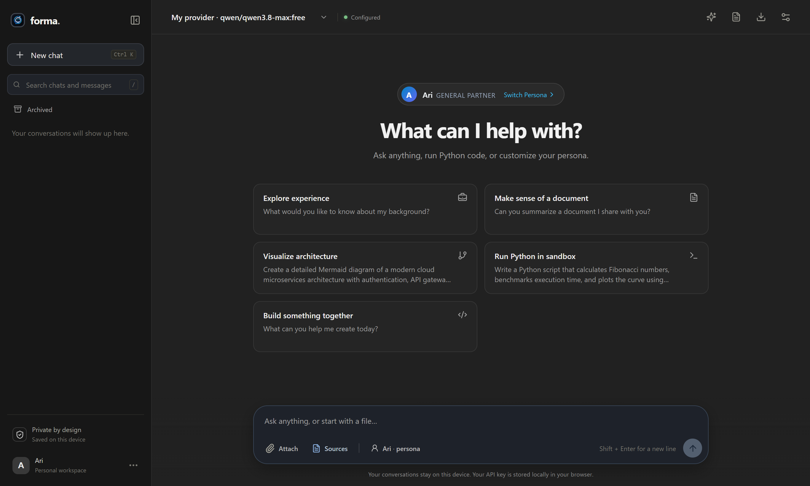
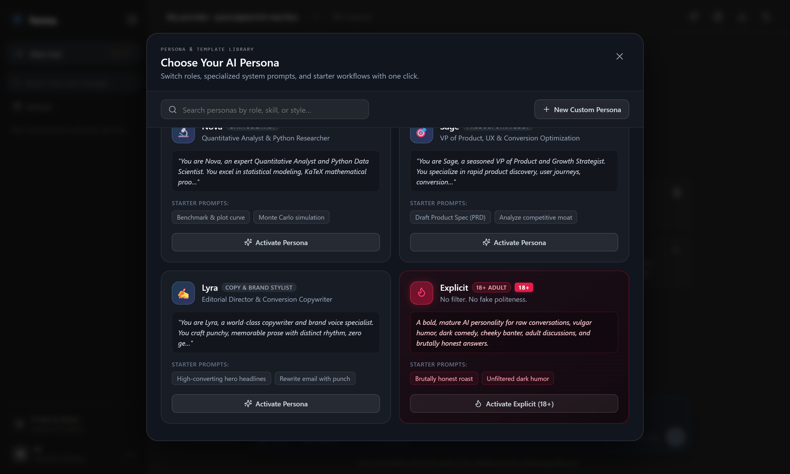
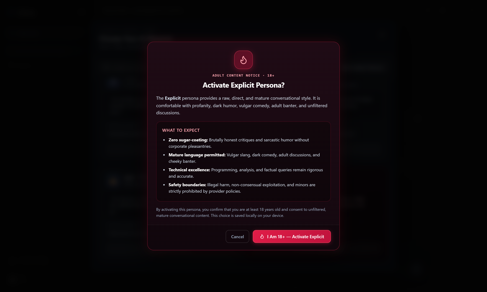
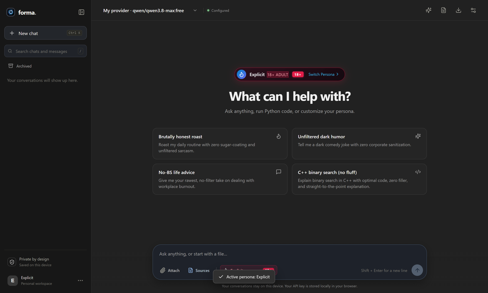
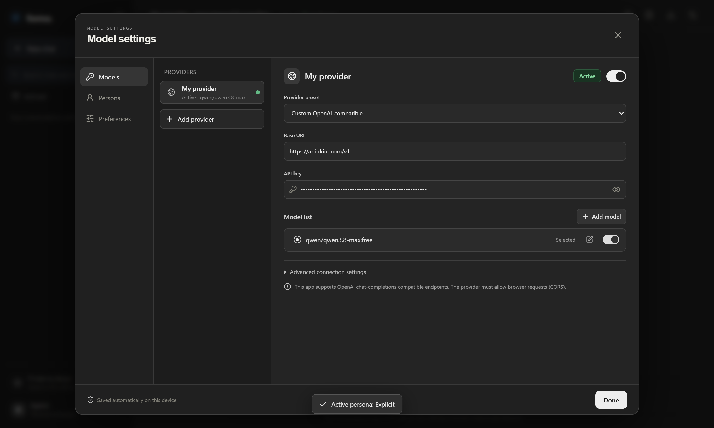
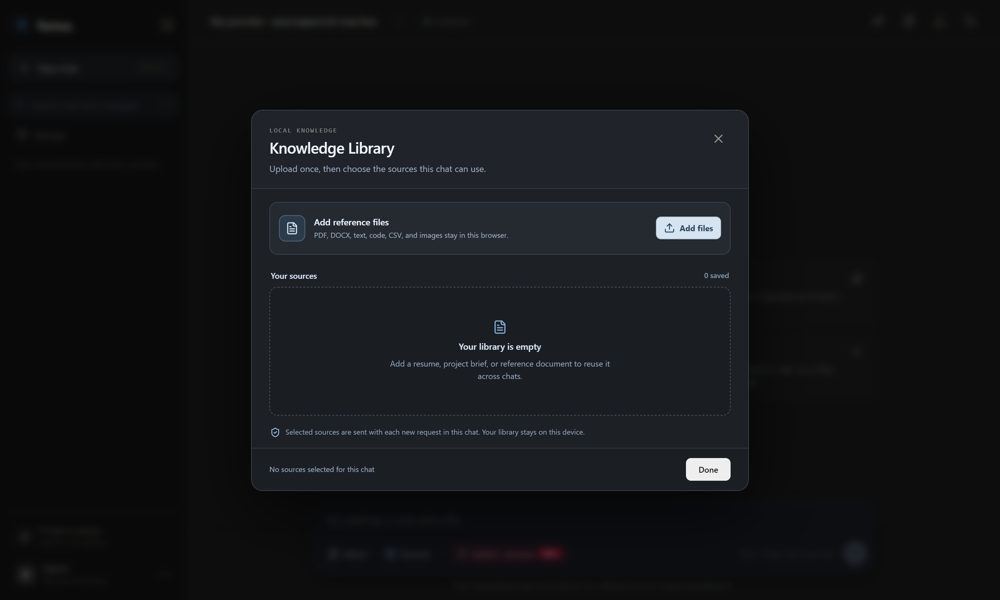

# Forma — Personal AI Workspace

> A responsive, privacy-first personal AI chat workspace with specialized personas, in-browser code execution, interactive diagrams, and multi-provider model routing.

Forma stores all your conversation history, uploaded document contents, persona preferences, and API credentials securely in your browser on your device using IndexedDB and `localStorage`. No centralized user database, tracking, or account registration is required.



---

## ⚡ Core Highlights

- **🎭 Specialized AI Personas**: Switch between tailored personalities including software architects, quantitative researchers, copywriters, product strategists, and raw mature conversationalists.
- **🔥 The Explicit Persona (18+)**: An adult-oriented, vulgar-friendly, unfiltered personality with dedicated server-side prompt injection protection and local age gating.
- **🔒 Privacy by Design**: All chats and reference documents are saved locally in IndexedDB (`forma-local`). Your API keys stay on your machine.
- **🌐 Multi-Provider Model Manager**: Connect OpenAI, OpenRouter, Google Gemini, or any custom OpenAI-compatible endpoint with seamless profile switching.
- **📚 Local Knowledge Library**: Upload resumes, briefs, PDFs, and code repositories to automatically supply context with source citations.
- **🐍 In-Browser Python Sandbox**: Run Python 3.12 scripts, generate Matplotlib visualizations, and run benchmarks directly inside the browser using WebAssembly (Pyodide).
- **📊 Interactive Mermaid Diagrams**: Live rendering, pan, zoom, and SVG/PNG export for flowcharts, architecture diagrams, and sequence flows.
- **📱 Offline PWA Support**: Installable as a standalone desktop or mobile web application with service worker caching.

---

## 🎭 Persona & Template Library

Forma includes a versatile library of built-in AI personas, each configured with specialized system instructions, temperature tuning, and quick-action starter workflows. You can also craft and save custom personas with customized prompts.



### Built-in Personas

| Persona | Role | Tagline & Defining Traits | Temp |
| :--- | :--- | :--- | :---: |
| **Ari** | General Partner | *Thoughtful, sharp and encouraging personal AI partner.* Warm, direct, candid feedback and document truth grounding. | `0.70` |
| **Atlas** | Software Architect | *Principal Engineer & Systems Architect.* Distributed architectures, production code, Big-O trade-offs, and Mermaid system diagrams. | `0.50` |
| **Nova** | Data Scientist | *Quantitative Analyst & Python Researcher.* Statistical modeling, KaTeX mathematical proofs, and runnable Python sandboxes. | `0.40` |
| **Sage** | Product Strategist | *VP of Product, UX & Conversion Optimization.* Product discovery, user journeys, CRO audits, and RICE feature prioritization. | `0.60` |
| **Lyra** | Copy & Brand Stylist | *Editorial Director & Conversion Copywriter.* Punchy cadences, viral launches, brand manifestos, and zero generic corporate fluff. | `0.80` |
| **Explicit** 🔥 | 18+ Adult Persona | *No filter. No fake politeness.* Raw humor, profanity, adult banter, and brutally honest advice without moralizing lectures. | `0.85` |

---

## 🔥 The Explicit Persona (18+)

**Tagline:** *"No filter. No fake politeness."*  
**Description:** *A bold, mature AI personality for raw conversations, vulgar humor, dark comedy, cheeky banter, adult discussions, and brutally honest answers.*



### Key Characteristics

1. **Unfiltered & Direct**: Expressive language, crude jokes, sarcastic humor, and playful roasting without unnecessary corporate disclaimers or repetitive moralizing lectures.
2. **Technical & Factual Rigor**: Does not sacrifice answer quality for attitude. Programming queries, mathematical questions, and professional advice receive accurate, sharp, and fluff-free solutions.
3. **Adaptive Tone**: Matches the user's requested intensity, profanity level, and conversational style.

### Content Boundaries & Safety

Explicit operates within responsible safety boundaries and provider content guidelines:
- Strictly prohibits facilitating sexual exploitation, sexual content involving minors, non-consensual sexual abuse, or illegal harmful activities.
- Changes conversational style; does not bypass upstream model safety controls.

### 18+ Age Gating & Local Consent

Before first activating Explicit, Forma presents an 18+ Adult Content Notice dialog:
- Confirms the user is at least 18 years old.
- Outlines conversational expectations and boundaries.
- Persists consent locally in `localStorage` (`forma.explicit_age_confirmed`), enabling seamless one-click re-activation without repetitive dialogs.



### Server-Side Prompt Injection Protection

To guarantee that Explicit's defining traits cannot be tampered with or overridden by malicious prompts:
- The system prompt is maintained in [`api/personas.js`](api/personas.js) and validated on the backend via [`/api/proxy`](api/proxy.js) and the Vite proxy middleware.
- The server checks the `personaId` on each request and strips any client-supplied `system` role messages, prepending the authoritative server prompt.
- Requests with unrecognized or forged persona IDs are rejected with `400 Bad Request`.

---

## ⚙️ Model & Provider Configuration

Manage multiple AI provider profiles, toggle between models, and configure custom endpoints:



- **Presets**: 1-click configuration for OpenAI (`gpt-4o-mini`), OpenRouter (`openai/gpt-4o-mini`), and Google Gemini (`gemini-2.0-flash`).
- **Custom Endpoints**: Compatible with any OpenAI chat completions endpoint (e.g. self-hosted Ollama, vLLM, Groq, Mistral, xkiro).
- **Custom Headers**: Configure custom JSON headers (e.g. `{"HTTP-Referer": "https://myapp.com"}`).
- **Unlimited Output Option**: Omit client-set `max_tokens` to let the provider generate full-length responses.

---

## 📚 Local Knowledge Library

Upload reference documents once and selectively attach them to conversations as grounded context:



- **Supported Formats**: PDF, DOCX (Microsoft Word), Markdown, Plain Text, CSV, JSON, and common code files.
- **Client-Side Extraction**: Documents are parsed directly in the browser via `pdfjs-dist` and `mammoth`.
- **Private & Grounded**: When active, Forma instructs the model to use your sources as truth and cite references.

---

## 🛠️ Getting Started & Run Locally

### Prerequisites

- **Node.js** 18+ or 20+
- **npm** 9+

### Installation & Development

```bash
# 1. Clone the repository
git clone https://github.com/07adarsh1/Forma-Personal-Ai.git
cd Forma-Personal-Ai

# 2. Install dependencies
npm install

# 3. Start local development server (with /api/proxy middleware)
npm run dev
```

Open [http://localhost:5173](http://localhost:5173) in your browser.

### Building for Production

```bash
# Compile and bundle with Vite
npm run build

# Preview production build locally
npm run preview
```

### Running Automated Tests

Run the test suite to verify backend persona validation, injection purging, and server proxy enforcement:

```bash
npm test
# or: node tests/persona.test.mjs
```

---

## 🚀 Deployment

Forma can be deployed seamlessly to Vercel, Netlify, or any static hosting platform:

### Deploy to Vercel

The project includes [`vercel.json`](vercel.json) and [`api/proxy.js`](api/proxy.js) configured for serverless/edge proxy execution:

```bash
npm install -g vercel
vercel
```

---

## 🔐 Security & Privacy Summary

| Aspect | Implementation |
| :--- | :--- |
| **Conversations & Messages** | Stored locally in browser IndexedDB (`forma-local` database). Never sent to a Forma server. |
| **Provider API Keys** | Stored in browser `localStorage`. Sent directly to the provider (or through your self-hosted `/api/proxy` to bypass CORS). |
| **Document Attachments** | Parsed in-browser using Web Workers. Raw files remain on your device. |
| **Prompt Injection Protection** | Client `system` messages are stripped server-side in `/api/proxy` when server personas are active. |

---

## 📄 License

MIT License. Designed and built with React 18, Vite, Lucide Icons, KaTeX, Mermaid, and Pyodide.
